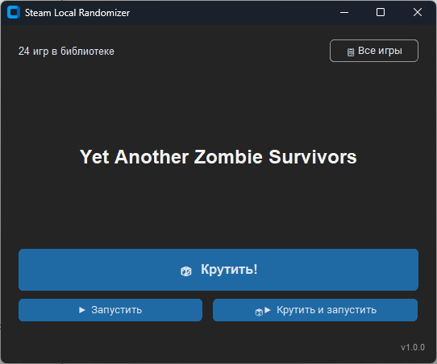

# 🎲 Steam Local Randomizer

[](https://www.python.org/)
[]()
[](LICENSE)
[](https://github.com/Serpus/steam-local-randomizer/releases)
[](https://github.com/Serpus/steam-local-randomizer/actions/workflows/release.yml)
[](https://github.com/Serpus/steam-local-randomizer/issues)
[](https://github.com/Serpus/steam-local-randomizer/actions/workflows/tests.yml)

[](docs/screenshot.png)

Устали думать, во что поиграть? **Steam Local Randomizer** находит установленный Steam,
сканирует **все** ваши библиотеки и выбирает игру за вас. Никаких Steam API-ключей,
аккаунтов и регистрации — всё работает локально.

## ✨ Возможности

- 🔍 Автоматически находит установленный Steam.
- 📚 Читает игры **во всех** библиотеках, а не только в основной папке.
- 🎯 Работает с играми на внешних дисках и SSD.
- 🚫 Автоматически исключает инструменты (Proton, SteamVR, Steam Linux Runtime, Redistributables, Wallpaper Engine).
- 🎰 **Эффект рулетки** — при нажатии «Крутить!» игры быстро перебираются, затем плавно замедляются и останавливаются на одной.
- 🎮 **Крутить и запустить** — выбор и мгновенный запуск игры в один клик.
- 📋 **Все игры** — список всех установленных игр с кнопкой запуска у каждой.
- 📚 **Вся библиотека** — переключатель, который включает в выборку не только установленные игры, но и все купленные в Steam (включая те, что сейчас не установлены).
- 🖥 Две версии: **GUI** (окно с кнопкой) и **CLI** (командная строка для скриптов).

## 📥 Скачать

Скачайте последнюю версию со страницы [**Releases**](https://github.com/Serpus/steam-local-randomizer/releases):

### 🪟 Windows

- **`steam-randomizer-gui-windows.exe`** — обычная версия с окном. Двойной клик — и готово.
- **`steam-randomizer-windows.exe`** — консольная версия для скриптов и автозапуска.

Установка Python и других программ **не требуется** — всё уже внутри.

> ⚠️ При первом запуске Windows SmartScreen может показать предупреждение
> («Windows защитила ваш компьютер»). Нажмите **«Подробнее» → «Выполнить в любом случае»** —
> это стандартное поведение для неподписанных `.exe`. Код открыт, вы можете проверить
> его самостоятельно или собрать `.exe` самому.

### 🐧 Linux

- **`steam-randomizer-gui-linux`** — GUI версия с окном.
- **`steam-randomizer-linux`** — консольная версия для скриптов.

**Как запустить:**

```bash
# Сделайте файл исполняемым (только в первый раз)
chmod +x steam-randomizer-gui-linux

# Запустите
./steam-randomizer-gui-linux
```

**Системные требования:**

- Установленный Steam (из пакетного менеджера дистрибутива, Flatpak или с официального сайта).
- Для GUI-версии нужен установленный пакет `python3-tk` (обычно уже стоит в системе, если установлен Python с Tkinter):
  - **Ubuntu / Debian / Mint:** `sudo apt install python3-tk`
  - **Fedora:** `sudo dnf install python3-tkinter`
  - **Arch Linux:** `sudo pacman -S tk`

> 💡 Приложение поддерживает установку Steam через **Flatpak** (`com.valvesoftware.Steam`) и стандартную установку в `~/.steam/steam` или `~/.local/share/Steam`.

## 🚀 Использование

### GUI (графическое окно)

Запустите `steam-randomizer-gui-windows.exe` (Windows) или `./steam-randomizer-gui-linux` (Linux). Появится тёмное окно:

- **🎲 Крутить!** — запустить рулетку: игры быстро перебираются и плавно замедляются до остановки.
- **▶ Запустить** — запустить выбранную игру.
- **🎲▶ Крутить и запустить** — выбрать и запустить игру в один клик.
- **📋 Все игры** — открыть список всех игр с кнопкой ▶ у каждой.
- **Вся библиотека** — чекбокс под шапкой. При включении загружает полный список купленных игр из локальных файлов Steam и Steam Store API. Неустановленные игры помечаются «· не установлена» в списке.

В строке статуса видно, сколько игр найдено в библиотеке.

> ℹ️ Названия **неустановленных** игр подгружаются из Steam Store API при первом включении чекбокса и кэшируются на 7 дней в `%APPDATA%\steam-local-randomizer\` (Windows) или `~/.config/steam-local-randomizer/` (Linux). Если интернета нет — приложение **молча** откатывается на локальные данные (манифесты + реестр Windows), игры без названия отображаются как `App <id>`. Никаких ошибок и зависаний.
>
> 💡 Названия **некоторых** (менее 5%) неустановленных игр могут отображаться как `App <id>` — обычно это удалённые из магазина игры или скрытые сервисные приложения. Для 95%+ библиотеки названия подгружаются корректно.

### CLI (командная строка)

Для продвинутых пользователей и скриптов — `steam-randomizer-windows.exe` (Windows) или `./steam-randomizer-linux` (Linux):

```
steam-randomizer                  # выбрать случайную игру
steam-randomizer --list           # показать список всех установленных игр
steam-randomizer --include-tools  # включить Proton, SteamVR и т.п. в пул
steam-randomizer --version        # версия
```

Пример вывода:

```
Steam found at: C:\Program Files (x86)\Steam
Pool size: 42 games

🎲 Your random game: Hades (appid 1145360)
```

### 🐧 Linux и Steam Deck

Приложение работает нативно на любом дистрибутиве Linux и на Steam Deck (SteamOS).

**Способ 1 — готовые бинарники из Releases (самый простой):**

Скачайте `steam-randomizer-gui-linux` или `steam-randomizer-linux` со страницы Releases,
сделайте исполняемым (`chmod +x`) и запустите. Всё!

**Способ 2 — из исходников (рекомендуется для Steam Deck):**

```bash
git clone https://github.com/Serpus/steam-local-randomizer.git
cd steam-local-randomizer
python3 -m venv .venv && source .venv/bin/activate
pip install -e .

# CLI:
steam-randomizer --list
steam-randomizer

# GUI (в режиме рабочего стола KDE / GNOME):
steam-randomizer-gui
```

На Steam Deck: переведите консоль в режим рабочего стола (`Steam → Power →
Switch to Desktop`), откройте **Konsole** и выполните команды выше. Чтобы запустить
приложение из режима Big Picture, добавьте его как «стороннюю игру»
(`Steam → Add a Game → Add a Non-Steam Game`) и в свойствах укажите команду запуска,
например `bash -lc "~/.local/bin/steam-randomizer-gui"` (или путь к вашему `.venv`).

**Поиск Steam на Linux.** По умолчанию используются стандартные пути
(`~/.steam/root`, `~/.local/share/Steam`, Flatpak-каталоги). Если Steam стоит в
нестандартном месте, задайте переменную окружения:

```bash
export STEAM_PATH=/path/to/Steam
```

**Запуск игр.** На Linux игры запускаются через `xdg-open steam://rungameid/<appid>`;
если `xdg-open` недоступен, используется бинарник `steam` или
`flatpak run com.valvesoftware.Steam`. На Steam Deck это открывает игру так же, как
обычный запуск из клиента.

**Flatpak-версия Steam.** Если Steam установлен через Flatpak, приложение само найдёт
библиотеки в `~/.var/app/com.valvesoftware.Steam/data/.steam/root`. Если нет — укажите
путь через `STEAM_PATH`.

**Настройки и кэш.** На Linux файлы лежат в `$XDG_CONFIG_HOME/steam-local-randomizer/`
(по умолчанию `~/.config/steam-local-randomizer/`).

## 🛠 Как это работает

1. **Поиск Steam.**
   - *Windows:* читает ключ `SteamPath` из реестра
     `HKEY_CURRENT_USER\Software\Valve\Steam`. Если ключа нет — пробует стандартные пути
     `C:\Program Files (x86)\Steam` и `C:\Program Files\Steam`.
   - *Linux / SteamOS:* пробует переменную окружения `STEAM_PATH`, затем стандартные
     расположения: `~/.steam/root`, `~/.local/share/Steam`, Flatpak-директории
     (`~/.var/app/com.valvesoftware.Steam/...`). На Steam Deck используется нативный путь
     `~/.steam/root` (он же `/home/deck/.local/share/Steam`).
2. **Поиск библиотек.** Парсит `steamapps/libraryfolders.vdf` и получает список
   **всех** папок с играми (включая другие диски и внешние SSD).
3. **Сканирование.** В каждой библиотеке находит файлы `appmanifest_*.acf`
   и достаёт название игры и её `appid`.
4. **Фильтрация.** Исключает служебные записи: Proton, SteamVR,
   Steam Linux Runtime, Steamworks Common Redistributables, Wallpaper Engine.
5. **Выбор.** Берёт случайную игру из отфильтрованного пула.
   Запуск — через URI `steam://rungameid/<appid>`.
6. **Полная библиотека (опционально).** Если включён чекбокс «Вся библиотека»,
   читается `userdata/<id>/config/localconfig.vdf` — список всех приложений пользователя.
   Названия подтягиваются из трёх источников (в порядке приоритета):
   - `appmanifest_*.acf` — для установленных игр;
   - реестр Windows (`HKCU\Software\Valve\Steam\Apps\<id>\Name`) — для ранее запускавшихся;
   - Steam Store API (`IStoreBrowseService/GetItems`) — для остальных, с кэшем на 7 дней.

Всё остальное происходит **локально**. В интернет приложение обращается только при первом
включении чекбокса «Вся библиотека» — чтобы подгрузить названия игр, которых нет на диске.
Если интернета нет, всё работает без ошибок.

## 🧑‍💻 Сборка из исходников

### Windows

Запустите `build.bat` двойным кликом. Скрипт:

- создаст виртуальное окружение `.venv`,
- установит все зависимости из `pyproject.toml`,
- прогонит `pytest`,
- соберёт два `.exe` в папке `dist/`:
  - `dist/steam-randomizer-gui.exe`
  - `dist/steam-randomizer.exe`

### Linux

```bash
# 1. Установите системные зависимости
sudo apt install python3-tk patchelf   # Ubuntu / Debian / Mint
# sudo dnf install python3-tkinter patchelf   # Fedora
# sudo pacman -S tk patchelf                  # Arch Linux

# 2. Сделайте скрипт исполняемым
chmod +x build_linux.sh

# 3. Запустите сборку
./build_linux.sh
```

Скрипт:

- создаст виртуальное окружение `.venv`,
- установит все зависимости,
- прогонит `pytest`,
- соберёт два исполняемых файла в папке `dist/`:
  - `dist/steam-randomizer-gui`
  - `dist/steam-randomizer`

> 💡 `patchelf` нужен PyInstaller для корректной упаковки shared-библиотек (`.so`) в режим `--onefile`.
> Без него собранный бинарник может не запуститься на системах с другой версией `glibc`.

### CI / Автоматическая сборка

Каждый push тега `v*` запускает GitHub Actions, который:

1. Параллельно собирает билды под **Windows** (`windows-latest`) и **Linux** (`ubuntu-latest`).
2. Запускает тесты на обеих платформах.
3. Автоматически создаёт GitHub Release и прикрепляет 4 файла:
   - `steam-randomizer-gui-windows.exe`
   - `steam-randomizer-windows.exe`
   - `steam-randomizer-gui-linux`
   - `steam-randomizer-linux`

## 📄 Лицензия

[MIT](LICENSE) — используйте, форкайте, изменяйте как угодно.

## 🙏 Благодарности

- [vdf](https://pypi.org/project/vdf/) — парсинг Valve Data Format.
- [CustomTkinter](https://github.com/TomSchimansky/CustomTkinter) — современный GUI для Tkinter.